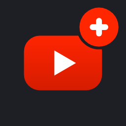
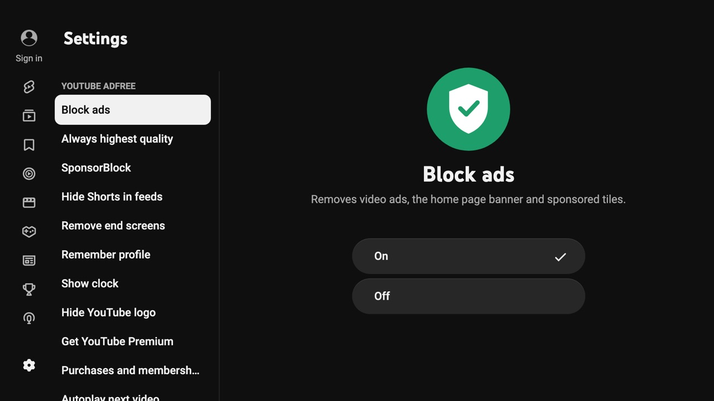
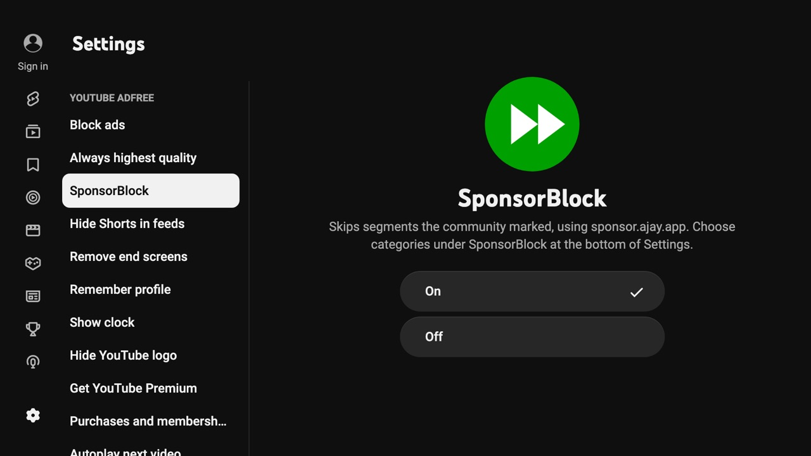
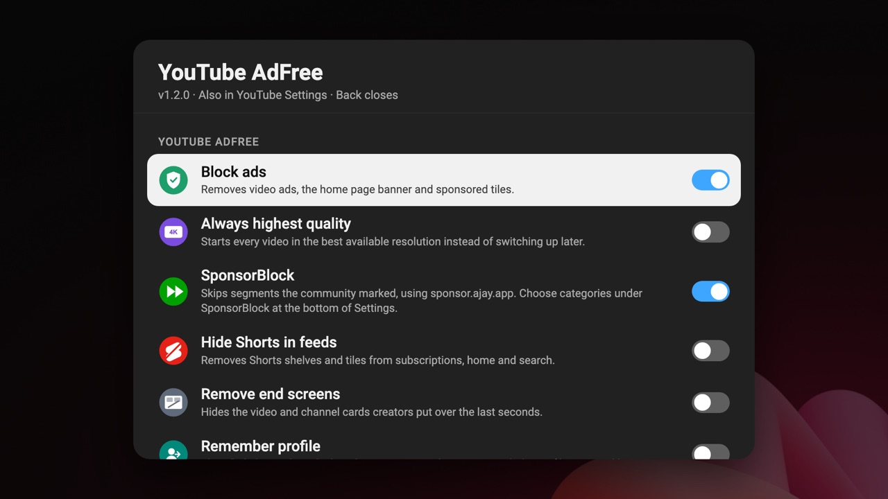

<p align="center">
  
</p>

<h1 align="center">YouTube AdFree for LG webOS</h1>

<p align="center">
  <b>YouTube on your LG TV without ads, with SponsorBlock, sharper thumbnails and smooth playback – set up from YouTube's own Settings page.</b>
</p>

<p align="center">
  <a href="https://github.com/Zucchiniii/youtube-webos/releases/latest"></a>
  <a href="https://github.com/Zucchiniii/youtube-webos/releases"></a>
  
  
  <a href="LICENSE"></a>
</p>

<p align="center">
  <a href="#install-with-homebrew-channel-recommended"><b>Install</b></a> ·
  <a href="https://zucchiniii.github.io/youtube-webos/">Website</a> ·
  <a href="#settings">Settings</a> ·
  <a href="#troubleshooting">Troubleshooting</a> ·
  <a href="CHANGELOG.md">Changelog</a>
</p>

<p align="center">
  
</p>

---

## Why this fork

This is an optimized fork of [webosbrew/youtube-webos](https://github.com/webosbrew/youtube-webos), tuned on an LG C5 (webOS 25/26) to be **fast, reliable and easy to use**:

- **No colour buttons needed.** All options are real On/Off toggles in **YouTube's own Settings page**, so it works with the new Magic Remote, which has no coloured buttons.
- **No black screens.** Opening a video shows a smooth transition instead of black, and a video stuck on a black loading screen recovers by itself.
- **Previews become the video.** Press OK on a playing preview and it carries on in full screen without stopping or reloading.
- **Settings stay put.** YouTube sometimes wipes its storage, which used to reset everything. That can't happen any more.
- **Sharp thumbnails everywhere.** 1280×720 instead of the blurry 320×180 the TV normally gets.
- **Same app ID as the original.** Installing over the upstream version keeps your YouTube sign-in and settings.

## Features

|     | Feature                                       | What it does                                                                                                                                                                     |
| :-: | --------------------------------------------- | -------------------------------------------------------------------------------------------------------------------------------------------------------------------------------- |
| 🛡️  | **Ad blocking**                               | Removes video ads, the home page banner and sponsored tiles.                                                                                                                     |
| ⏩  | **[SponsorBlock](https://sponsor.ajay.app/)** | Skips sponsor reads, intros, outros, "like and subscribe" reminders and more. Segments are shown on the progress bar, and a small note in the corner tells you what was skipped. |
| 🎬  | **Smooth video launch**                       | The tile you pick grows to full screen and shows the thumbnail, title and a loading bar until the video plays. No black frames.                                                  |
| 🔁  | **Seamless previews**                         | OK on a playing preview grows it into the full-screen video with the sound uninterrupted.                                                                                        |
| 👤  | **Remember profile**                          | Skips the "Who's watching?" screen and opens your last profile.                                                                                                                  |
| 🖼️  | **HD thumbnails**                             | Every tile type uses 1280×720 thumbnails (always on).                                                                                                                            |
| 🩹  | **Black-screen recovery**                     | A watchdog spots a video stuck loading and fixes it step by step (always on).                                                                                                    |
| 📺  | **Always highest quality**                    | Starts videos in the best resolution instead of switching up later.                                                                                                              |
| 🚫  | **Hide Shorts**                               | Removes Shorts shelves and tiles from home, subscriptions and search.                                                                                                            |
| 🧹  | **Remove end screens**                        | Hides the video and channel cards over the last seconds.                                                                                                                         |
| 🕒  | **Clock**                                     | An on-screen clock overlay.                                                                                                                                                      |
| 🎧  | **Audio only**                                | The 🟦 blue button turns the picture off and keeps the sound.                                                                                                                    |
| 🌍  | **English and Swedish**                       | Follows the TV's language.                                                                                                                                                       |

## Screenshots

<table>
  <tr>
    <td width="50%"><br><sub><b>YouTube Settings.</b> The options are at the top of YouTube's own Settings page.</sub></td>
    <td width="50%"><br><sub><b>SponsorBlock.</b> Pick which categories to skip at the bottom of Settings.</sub></td>
  </tr>
  <tr>
    <td colspan="2"><br><sub><b>Quick panel.</b> Remotes with a 🟩 green button open the same options as an overlay, handy during playback.</sub></td>
  </tr>
</table>

---

## Install with Homebrew Channel (recommended)

You need [Homebrew Channel](https://github.com/webosbrew/webos-homebrew-channel) on the TV (rooted TV, or Developer Mode). Adding this repository once gives you the app **and every future update**.

> [!IMPORTANT]
> Uninstall the official YouTube app first. Both use the same app ID, so only one can be installed.

1. Open **Homebrew Channel** and select the ⚙️ **Settings** icon.
2. Select **Add repository** and type:

   ```text
   https://zucchiniii.github.io/youtube-webos/repo.json
   ```

3. Go back to the app list, open **YouTube AdFree** and select **Install**. The default webosbrew repository also lists the original "YouTube AdFree" with a red cone icon; pick the one with the black icon, whose page says "from zucchiniii.github.io".

That's it. Homebrew Channel will offer updates whenever a new version is released.

<details>
<summary><b>Rooted TV: skip the typing</b></summary>

Run this on the TV over SSH or Telnet. It opens Homebrew Channel with the repository address already filled in, so you only need to confirm:

```sh
luna-send -n 1 luna://com.webos.applicationManager/launch '{"id":"org.webosbrew.hbchannel","params":{"launchMode":"addRepository","url":"https://zucchiniii.github.io/youtube-webos/repo.json"}}'
```

</details>

<details>
<summary><b>Already added the old repository address?</b></summary>

The old address, `https://raw.githubusercontent.com/Zucchiniii/youtube-webos/main/homebrew-repository.json`, keeps working. You don't need to change anything.

</details>

### Other ways to install

- **[webOS Dev Manager](https://github.com/webosbrew/dev-manager-desktop):** download the `.ipk` from the [latest release](https://github.com/Zucchiniii/youtube-webos/releases/latest) and install it from the Apps tab.
- **Command line:** see [Development](#development) below.

---

## Settings

Open YouTube's **Settings** (⚙️ in the left menu). The **YouTube AdFree** category is at the top. The SponsorBlock categories and _Reset / About_ are at the bottom.

| Option                 | Default | What it does                                                                         |
| ---------------------- | :-----: | ------------------------------------------------------------------------------------ |
| Block ads              |   On    | Removes video ads, the home page banner and sponsored tiles.                         |
| Always highest quality |   Off   | Starts every video in the best available resolution.                                 |
| SponsorBlock           |   On    | Skips community-marked segments, using [sponsor.ajay.app](https://sponsor.ajay.app). |
| Hide Shorts in feeds   |   Off   | Removes Shorts shelves and tiles.                                                    |
| Remove end screens     |   Off   | Hides the cards creators put over the last seconds.                                  |
| Remember profile       |   Off   | Skips "Who's watching?" and opens your last profile.                                 |
| Show clock             |   Off   | Shows the time in the corner.                                                        |
| Hide YouTube logo      |   Off   | Hides the logo in the top corner.                                                    |

**SponsorBlock categories:** sponsors, self-promotion, interaction reminders, intros, outros and non-music parts of music videos are skipped by default. Previews and recaps are off by default.

Bug fixes such as black-screen recovery and HD thumbnails are always on and have no switch.

### Remote buttons

| Button   | Action                                                                  |
| -------- | ----------------------------------------------------------------------- |
| 🟩 Green | Opens the quick panel with the same options (on remotes that have one). |
| 🟦 Blue  | Audio only: turns the picture off and keeps playing the sound.          |
| ⬅️ Back  | Closes the quick panel.                                                 |

---

## Troubleshooting

<details>
<summary><b>"Installation failed" or the app doesn't show up</b></summary>

Uninstall the official YouTube app first. It uses the same app ID (`youtube.leanback.v4`).

</details>

<details>
<summary><b>My settings were reset</b></summary>

Since 1.0.0 settings are mirrored to a second storage that YouTube can't wipe. If you are on an older version, update.

</details>

<details>
<summary><b>The "Who's watching?" screen still shows up</b></summary>

Turn on **Remember profile** in Settings → YouTube AdFree. The app then skips the screen on every start.

</details>

<details>
<summary><b>A video stays black</b></summary>

The black-screen recovery normally fixes this within a few seconds. If it keeps happening, turn off **Always highest quality** and [open an issue](https://github.com/Zucchiniii/youtube-webos/issues) with your TV model and webOS version.

</details>

<details>
<summary><b>Start YouTube automatically when the TV turns on</b></summary>

Run this on the TV over SSH or Telnet. The app then shows up as an input source and starts automatically if it was the last app used:

```sh
luna-send-pub -n 1 'luna://com.webos.service.eim/addDevice' '{"appId":"youtube.leanback.v4","pigImage":"","mvpdIcon":""}'
```

To turn it off again:

```sh
luna-send-pub -n 1 'luna://com.webos.service.eim/deleteDevice' '{"appId":"youtube.leanback.v4"}'
```

</details>

---

## What this fork changes

<details>
<summary><b>Technical details</b></summary>

- **Settings inside YouTube.** The options are injected as native categories into YouTube's `account/get_setting` response, so they are real On/Off toggles. The quick panel was rewritten without the 1.7k-line spatial-navigation polyfill.
- **Settings can't reset.** YouTube TV's storage service calls `localStorage.clear()` in some flows. Settings are mirrored to IndexedDB, and `clear()`/`removeItem()` can no longer delete them.
- **Video launch.** The transition starts in the OK key handler, before YouTube swaps the page. The tile flies to full screen over a dimmed copy of its thumbnail and stays as a poster inside YouTube's player container, so YouTube's controls stay on top. It fades into the video once playback has run for 0.5 s. Measured on an LG C5: no black frames.
- **Preview → video.** YouTube's server marks TV previews `blockAdoption: true`, so OK on a preview reloaded the video. The flag is cleared, so playback continues with sound. The TV's hardware video plane only moves about every 300 ms, so the motion is drawn by a thumbnail card that grows at full frame rate and dissolves into the playing video.
- **Remember profile.** Snoozes YouTube's start-up screen records (`recurring_actions`) on every start, with a `startAccountSelectorCommand` hook as a fallback.
- **Black loading screen.** A watchdog detects a video stuck buffering with nothing loaded and escalates step by step: re-show the video surface → play → seek in place → reopen.
- **Highest quality.** Writes YouTube's own `yt-player-quality` preference before playback instead of forcing a switch after the start, which could trigger a black screen.
- **Thumbnails.** Upgrades every tile type (the current UI uses `<image>`, which upstream missed) by hooking the style and preload assignment. Falls back to `sddefault` and then the original when a video has no HD frame.
- **SponsorBlock.** Segments are drawn as a CSS gradient on the progress bar, because YouTube's incremental DOM recycled upstream's overlay `<div>`.
- **Performance.** One `JSON.parse` hook instead of three, no deep clone on every `JSON.stringify`, a modern build for webOS 22+ and no CSS source maps (userScript 272 KB → 88 KB). `pnpm run build:legacy` still targets webOS 1–21.

</details>

---

## Development

<details>
<summary><b>Build, install and debug</b></summary>

### Requirements

- **Node.js**: the latest LTS release (see `devEngines` in [`package.json`](package.json) for the minimum).
- **pnpm**: run `corepack enable` if you already have Node.js.
- **git**

### Build an IPK

```sh
git clone https://github.com/Zucchiniii/youtube-webos.git
cd youtube-webos
pnpm install
pnpm run build && pnpm run package
```

The `.ipk` is written to the project root. Use `pnpm run build:legacy` for webOS 21 and older.

### Set up the TV

**Developer Mode TV:**

1. Create an [LG Developer account](https://webostv.developer.lge.com/login).
2. Install the [Developer Mode app](https://in.lgappstv.com/main/tvapp/detail?appId=232503) from the LG Content Store.
3. Sign in to it and turn on **Developer Mode** and **Key Server**.
4. Run `pnpm exec ares-setup-device`, add the TV with the IP shown in the Developer Mode app, and enter the passphrase shown on the TV.

**Rooted TV:**

1. Turn on SSH in Homebrew Channel.
2. Add your public key to `/home/root/.ssh/authorized_keys` on the TV.
3. Add the device:

   ```sh
   pnpm exec ares-setup-device -a webos -i "username=root" -i "privatekey=id_rsa" -i "passphrase=SSH_KEY_PASSPHRASE" -i "host=TV_IP" -i "port=22"
   ```

### Install, launch and inspect

```sh
pnpm run deploy   # install on the default device
pnpm run launch   # start the app
pnpm run inspect  # open Chrome DevTools for the app
```

Open a specific video directly:

```sh
pnpm run launch -- -p '{"contentTarget":"v=F8PGWLvn1mQ"}'
```

</details>

---

## Credits

- [webosbrew/youtube-webos](https://github.com/webosbrew/youtube-webos), the project this fork is based on.
- [SponsorBlock](https://sponsor.ajay.app/) by Ajay Ramachandran and its contributors, for the segment data.
- [Homebrew Channel](https://github.com/webosbrew/webos-homebrew-channel) by webosbrew.

Licensed under [GPL-3.0](LICENSE). Not affiliated with YouTube, Google or LG.
